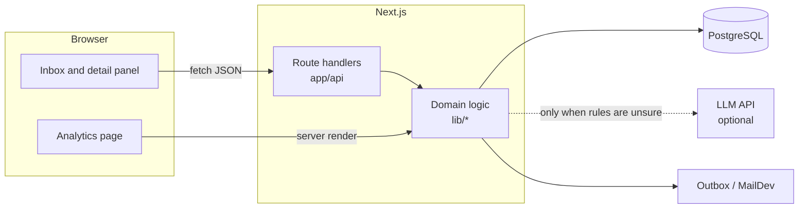
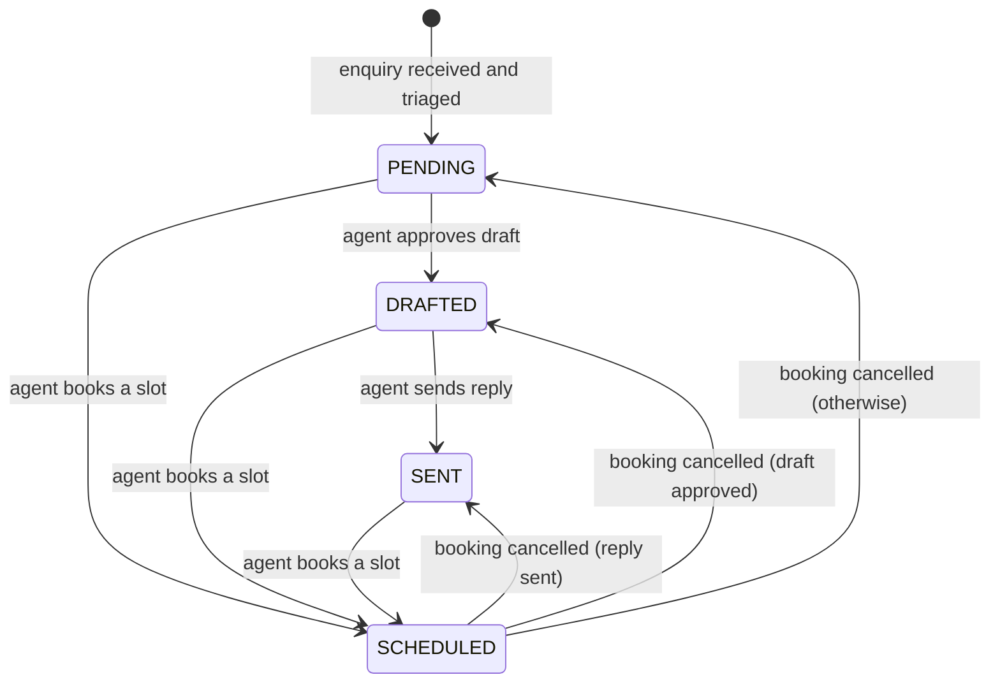

# Architecture

## Overview

The app is a single Next.js application (`apps/web`) backed by PostgreSQL.
Pages are server components that read data directly through Prisma.
Interactive parts (the inbox, detail panel and forms) are client components
that call JSON route handlers under `app/api`. Request bodies are validated
with Zod schemas from `packages/schema`, which the client and server share.

## Workflow and state

Status only moves forward, except when a booking is cancelled. Cancelling
returns the enquiry to the furthest step it had reached otherwise: `SENT` if
a reply went out, `DRAFTED` if a draft was approved, otherwise `PENDING`.
Each action writes an `EnquiryEvent` in the same database transaction.

| Step    | Route                                    | Module                        |
| ------- | ---------------------------------------- | ----------------------------- |
| Intake  | `POST /api/enquiries`                    | `app/api/enquiries/route.ts`  |
| Triage  | `POST /api/enquiries/:id/triage`         | `lib/triage/triageEnquiry.ts` |
| Draft   | `POST /api/enquiries/:id/draft`          | `lib/drafting/hybridDraft.ts` |
| Approve | `POST /api/enquiries/:id/draft/accept`   | route handler (transaction)   |
| Preview | `GET /api/enquiries/:id/send`            | `lib/email/sendReply.ts`      |
| Send    | `POST /api/enquiries/:id/send`           | `lib/email/sendReply.ts`      |
| Resolve | `POST /api/enquiries/:id/send/mark-sent` | `lib/email/sendReply.ts`      |
| Slots   | `GET /api/enquiries/:id/slots`           | `lib/slots/*`                 |
| Book    | `POST /api/enquiries/:id/bookings`       | `lib/bookings/bookings.ts`    |
| Cancel  | `POST /api/bookings/:id/cancel`          | `lib/bookings/bookings.ts`    |

## Data model

- **Enquiry** is the customer message, with contact details, status and an
  optional linked **Property**.
- **triageResult** holds the intent, confidence, extracted entities, method
  (`rules`, `llm` or `rules-fallback`) and the needs-review flag.
- **DraftReply** holds the reply text, how it was produced (`template` or
  `llm`), and whether the agent edited it.
- **Slot** is a bookable viewing time for a property.
- **Booking** links an enquiry to a slot. `activeSlotId` is unique and set
  only while the booking is confirmed.
- **OutboundEmail** is one row per approved draft version, keyed by a
  unique idempotency key. Its status is `SENDING`, `SENT`, `FAILED` or
  `UNKNOWN`, and only `SENT` rows count as replies.
- **EnquiryEvent** is an append-only audit log, and the source for analytics.

## Key decisions

**Rules first, model second.** The rule engine is fast, free and
explainable, and it is right for most clear-cut enquiries. The model is
called only when the rules are unsure, which keeps cost and latency down and
means the app works with no API key at all. The labelled eval set
(`apps/web/evals`) measures this: every rule miss is a low-confidence result,
so routing on confidence sends the model exactly the cases it can help with.

**The model is never trusted blindly.**

- Its output must match a Zod schema.
- Extracted entities are dropped unless they appear in the message.
- Drafts are rejected if they mention a time that isn't a real available
  slot, claim a booking, or contain placeholders.
- Every failure falls back to deterministic behaviour, and the reason is
  recorded.

**Double-booking is prevented by the database, not just the code.**

- Booking runs in one transaction that locks the enquiry row.
- The slot is claimed with a conditional update.
- A unique index on `Booking.activeSlotId` makes a second confirmed booking
  for the same slot impossible, even under concurrent requests. The
  resulting conflict is returned as a clear `409 SLOT_UNAVAILABLE`.

**People stay in control.** Suggested slots are only suggestions, drafts
must be approved before they can be sent, and sending is simulated by
default. The app never contacts a customer or books a viewing on its own.

**Each reply is sent at most once by the app, but delivery is
at-least-once.** Before calling the mail transport, the app claims the send
by inserting an `OutboundEmail` row under a unique idempotency key, so two
concurrent requests can never both send the same draft. What the app cannot
do is make the transport and the database commit together. If the SMTP
server accepts the message and the app then crashes before it records
success, the claim is left in `SENDING` and nobody knows whether the
customer received it. The same is true of a timeout or a dropped
connection while the message is being sent: the transport reports an
error, but the server may already have accepted the message.

The app handles this conservatively:

- A `SENDING` claim older than five minutes becomes `UNKNOWN`. It is never
  retried automatically.
- The inbox shows the agent that the outcome is unknown. They check the sent
  folder, then either mark the reply as sent (nothing is sent) or confirm a
  resend.
- Every attempt carries the same `Message-ID` header, derived from the
  idempotency key, so if a duplicate does go out the mail client and the
  agent can recognise it as the same message.
- Transport errors are classified (`lib/email/sendErrors.ts`). Only a
  definite failure becomes `FAILED` and can be retried without
  confirmation: an SMTP 4xx or 5xx rejection, an authentication or
  envelope error, or a connection that was never established. Timeouts,
  resets and anything unrecognised become `UNKNOWN`.
- Recovery is atomic. Marking a reply as sent, a confirmed resend and a
  late success from the original attempt are each a single conditional
  update on the claim's status and claim time, inside the same
  transaction as the enquiry update and event. Whichever runs first wins,
  and the other changes nothing.

The real fix is a sending provider whose API accepts an idempotency key
(several transactional email APIs do). The provider would then drop a
repeated request itself, and the app could retry interrupted sends safely.
SMTP has no such mechanism.

**Metrics come from records.** Analytics are computed by a pure function
(`lib/analytics/metrics.ts`) from stored timestamps: first response time,
reply rate, viewing conversion and the share of drafts sent unedited.
Nothing is estimated.

## Testing

| Layer       | Where                        | What it covers                                                       |
| ----------- | ---------------------------- | -------------------------------------------------------------------- |
| Unit        | `lib/**/*.test.ts`, `tests/` | Triage rules, hybrid policy, draft checks, metrics, filters, schemas |
| Integration | `tests/integration/`         | Bookings and concurrency, sending, triage, intake against Postgres   |
| Eval        | `evals/`                     | Accuracy on 30 labelled enquiries, rules vs hybrid                   |

CI (`.github/workflows/ci.yml`) runs every check against a real Postgres
service on each push and pull request:

- migrations, plus a check that the schema matches them;
- lint and type-check;
- unit and integration tests;
- a production build.
